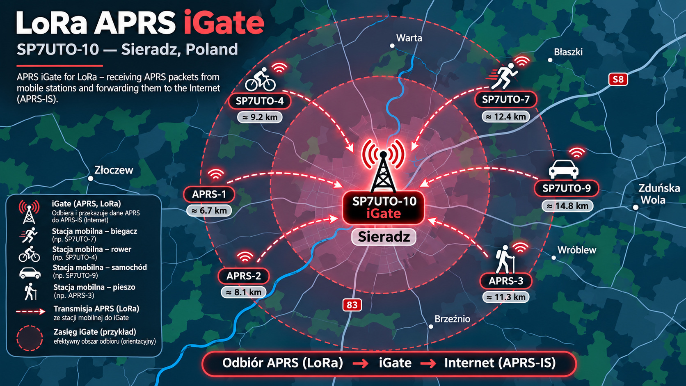
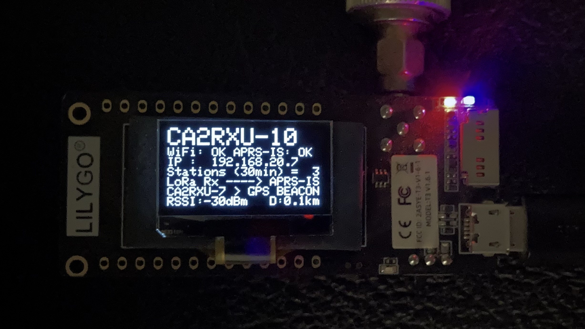
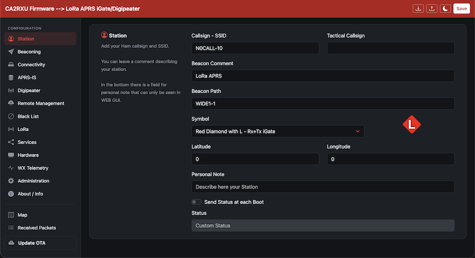
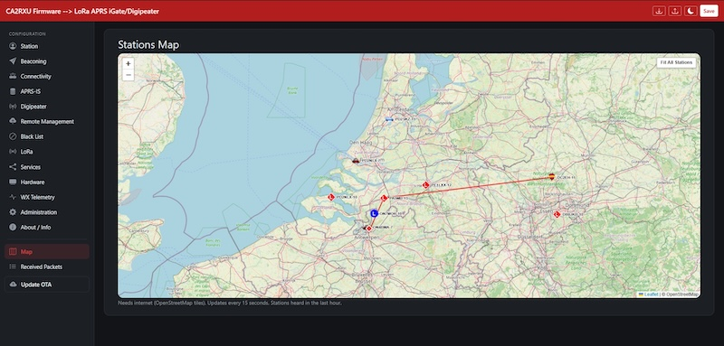
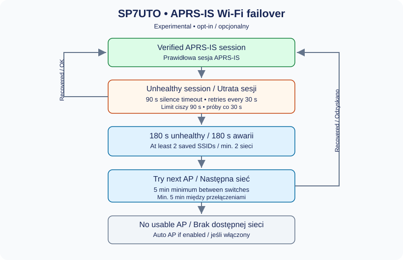

# Wi-Fi management / Zarządzanie Wi-Fi

*Mapa poglądowa — przykładowe stacje, pozycje, odległości i zasięg, nie dane z pomiarów. / Illustrative map — example stations, positions, distances and coverage, not measured data.*

**Experimental / Eksperymentalne** — CA2RXU upstream, GPL-3.0-or-later. Target ESP32 / Heltec V3.1.

*Oryginalne urządzenie / Upstream illustration: [CA2RXU](https://github.com/richonguzman/LoRa_APRS_iGate).*

## PL
Indywidualny DHCP lub statyczny IPv4 dla każdej sieci: IP, brama, maska, DNS1 i opcjonalny DNS2. Brak nowego pola w starszym JSON oznacza DHCP. Kolejność sieci pozostaje bez zmian. Brak IP oznacza nieudane połączenie. Nie instalować na bramce produkcyjnej przed testami.

Testy: stary JSON, DHCP, statyczny IPv4 bez DHCP, przełączenie przy braku DHCP, static -> DHCP, błędny IP, usunięcie środkowego profilu, restart, backup/restore, Auto AP, regresja W5500. Zachować kopię i dostęp USB. Walidacja podsieci, priorytety i kontrola APRS-IS pozostają do wykonania.

## EN
Per-network DHCP or static IPv4: IP, gateway, subnet, primary and optional secondary DNS. Older JSON defaults to DHCP. Existing network order retained. Missing IP means failed connection. Do not flash a production gateway before testing.

Tests: legacy JSON, DHCP, static-only AP, DHCP failure and next AP, static-to-DHCP, invalid IP, deleting middle profile, reboot, backup/restore, Auto AP, W5500 regression. Keep a backup and USB recovery. Subnet validation, priorities and APRS-IS health checks remain future work.

## Update 2 / Aktualizacja 2

PL: Kolejność AP można zmieniać przyciskami Move up / Move down (pierwszy profil ma najwyższy priorytet). Walidator sprawdza IPv4, ciągłą maskę /1–/30, adresy hosta, bramę w tej samej podsieci i DNS. DHCP resetuje adres do 0.0.0.0 zgodnie z Arduino-ESP32 2.0.17. Testy hosta: `g++ -std=c++11 -Wall -Wextra -Werror -Iinclude tests/wifi_ipv4_validation.cpp -o /tmp/wifi-ipv4-test && /tmp/wifi-ipv4-test`. Test fizyczny nadal wymagany.

EN: Move up / Move down controls set profile priority (first wins). Validator checks IPv4, contiguous /1–/30 masks, usable hosts, same-subnet gateway and DNS. DHCP reset uses 0.0.0.0 per Arduino-ESP32 2.0.17. The host test command above covers address validation only; hardware testing is still required.

## Update 3 / Aktualizacja 3

Opt-in APRS-IS session health failover, 3 min unhealthy window, 5 min cooldown, 90 s silent session timeout; no external probes or healthy failback. / Opcjonalny failover sesji APRS-IS, 3 min awarii, 5 min odstępu, 90 s ciszy; bez zewnętrznych sond i automatycznego powrotu. Boot authentication wait removed; bounded individual TCP attempts (DNS may still block). / Usunięto nieskończone oczekiwanie przy starcie; pojedyncze próby TCP, DNS może nadal blokować. See Wiki Network-Failover and Testing. Experimental, pending tests.

## Illustrations / Ilustracje

*Original upstream screenshots, not fork screenshots / Oryginalne zrzuty, nie interfejs forka.*

[Upstream PDF manual](https://drive.google.com/file/d/1Hff_Szd7ks8RC7_RiV6POxPJlclbO05M/view?usp=sharing) · [Wiki](https://github.com/sp7uto/LoRa_APRS_iGate/wiki)

## New configuration fields / Nowe pola konfiguracji

[DHCP screenshot](https://raw.githubusercontent.com/wiki/sp7uto/LoRa_APRS_iGate/images/sp7uto/ap-dhcp.png) · [Static IPv4 screenshot](https://raw.githubusercontent.com/wiki/sp7uto/LoRa_APRS_iGate/images/sp7uto/ap-static-ipv4.png) · [Priority and failover](https://raw.githubusercontent.com/wiki/sp7uto/LoRa_APRS_iGate/images/sp7uto/ap-priority-failover.png)

Generated from source during Wiki publishing; example values only. / Generowane z kodu podczas publikacji Wiki; wyłącznie dane przykładowe.

## Configuration generator / Generator konfiguracji

[Standalone HTML](../config-generator/index.html) · [Wiki PL/EN](https://github.com/sp7uto/LoRa_APRS_iGate/wiki/Configuration-Generator). Download raw HTML and open offline. / Pobierz HTML i otwórz lokalnie. RX-only new configuration or import/edit existing ESP32 backup with optional station profiles and masked diff; no server or telemetry.
