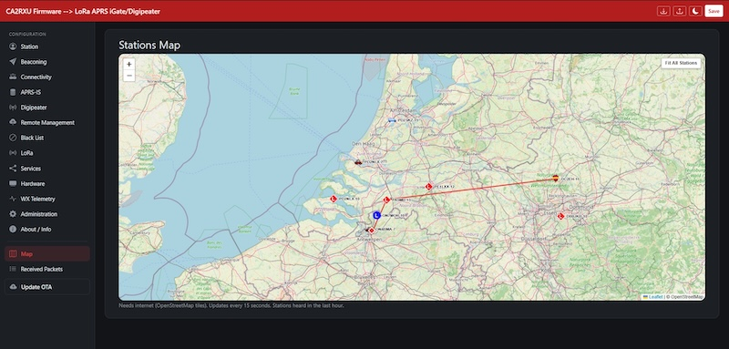

# 📶 APRS-IS

## PL

Funkcje APRS-IS pozostają zgodne z projektem bazowym. Ustaw prawidłowy znak, serwer, port i hasło APRS-IS. Przykładowy port filtrowanego połączenia to 14580. Nie publikuj prawdziwych danych logowania ani kopii konfiguracji. Dla RX-only pozostaw wyłączone TX, nadawanie beaconów przez RF, przekazywanie wiadomości i obiektów do RF oraz digipeater. Ustawienia radiowe muszą odpowiadać lokalnemu standardowi.

## EN

APRS-IS behavior follows upstream. Configure your callsign, server, port and passcode; filtered connections commonly use port 14580. Do not publish credentials or configuration backups. For RX-only operation disable LoRa TX, RF beacons, gating messages/objects to RF and digipeating. Match local radio settings.

*Mapa odebranych stacji w oryginalnym interfejsie / Original received-station map — [CA2RXU upstream](https://github.com/richonguzman/LoRa_APRS_iGate).*

