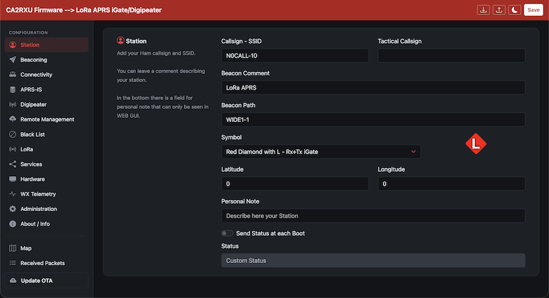

# Konfiguracja / Configuration

*Menu oryginalnego firmware; nowe pola IPv4 i failover opisano niżej / Upstream menu; new fork settings are described below — [CA2RXU upstream](https://github.com/richonguzman/LoRa_APRS_iGate).*

PL: Connectivity → WiFi Access → Add network. Wpisz SSID i hasło. Wybierz DHCP lub Static IPv4. W trybie statycznym podaj wolny adres urządzenia, maskę, bramę i DNS1; DNS2 jest opcjonalny. Brama musi leżeć w tej samej podsieci. Move up / Move down ustala kolejność prób. Zachowaj Auto AP jako drogę odzyskania.

EN: Connectivity → WiFi Access → Add network. Enter SSID and passphrase, then DHCP or Static IPv4. For static addressing supply an unused IP, subnet mask, gateway and primary DNS; secondary DNS is optional. Gateway must be on the same subnet. Use Move up / Move down to set connection order. Keep Auto AP enabled for recovery.

Example only / Przykład (nie kopiować bez sprawdzenia): 192.168.2.50, 255.255.255.0, gateway 192.168.2.1, DNS 9.9.9.9.

## Experimental APRS-IS WiFi failover

PL: Domyślnie OFF. Włączenie jest opcjonalne po testach podstawowych. Wymaga minimum dwóch SSID, aktywnego APRS-IS i wyłączonego Backup Digi. Szczegóły: [Network Failover](Network-Failover).

EN: Default OFF. Enable only after basic connectivity tests. Requires at least two SSIDs, active APRS-IS and backup digi disabled. See [Network Failover](Network-Failover).

## 📸 Nowe pola AP / New AP settings

Zrzuty wygenerowane automatycznie z kodu konfiguratora, z fikcyjnymi danymi. Nie są to zrzuty pracującego urządzenia. / Screenshots rendered automatically from the configuration source with fictional example data, not captured from a live device.

### DHCP

PL: W trybie DHCP pola statycznego IPv4 są ukryte. / EN: Static IPv4 fields are hidden in DHCP mode.

### Static IPv4

PL: IP address, Default gateway, Subnet mask i Primary DNS są wymagane; Secondary DNS jest opcjonalne. / EN: IP address, Default gateway, Subnet mask and Primary DNS are required; Secondary DNS is optional.

### Priorytety i failover / Priorities and failover

PL: Move up i Move down ustalają kolejność; opcjonalny failover APRS-IS i Auto AP są osobnymi funkcjami. / EN: Move up and Move down set priority; optional APRS-IS failover and Auto AP are separate functions.

## Generator konfiguracji / Configuration Generator

[Offline RX-only configuration generator](Configuration-Generator) — creates a complete JSON for Restore; no device access. / Tworzy kompletny JSON, bez łączenia z urządzeniem.
