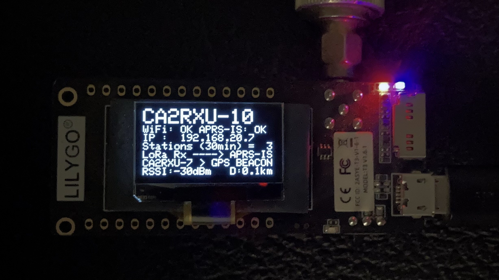

# 🧩 Sprzęt / Hardware

## PL

Główne urządzenie testowe: Heltec WiFi LoRa 32 V3.1 (ESP32-S3). Środowisko PlatformIO: `heltec_wifi_lora_32_V3`. Dodatkowe cele CI to `ttgo-lora32-v21` oraz `wiznet_5500_evb_pico2_e22p`. Kompilacja nie oznacza potwierdzonej zgodności sprzętowej. W5500 jest platformą regresyjną: nie dodajemy mu funkcji Wi-Fi.

## EN

Primary test board: Heltec WiFi LoRa 32 V3.1 (ESP32-S3), PlatformIO environment `heltec_wifi_lora_32_V3`. Additional CI targets are `ttgo-lora32-v21` and `wiznet_5500_evb_pico2_e22p`. A successful build does not prove hardware compatibility. The W5500 target is for Ethernet regression only.

Use the upstream board list for all other platforms; experimental support is unverified.

*Przykład wyświetlacza oryginalnego iGate, nie identyfikacja konkretnej rewizji Heltec / Upstream OLED example, not a verified Heltec board revision — [CA2RXU upstream](https://github.com/richonguzman/LoRa_APRS_iGate).*

