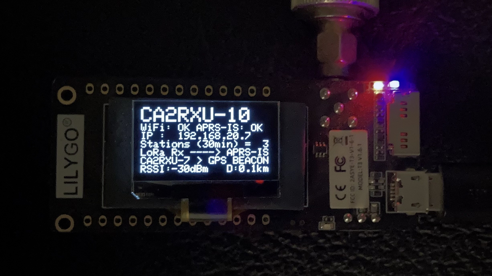

# LoRa APRS iGate — Wi-Fi Network Management

**SP7UTO experimental fork • CA2RXU upstream • GPL-3.0-or-later**

*Oryginalna bramka CA2RXU / Original CA2RXU iGate — [CA2RXU upstream](https://github.com/richonguzman/LoRa_APRS_iGate).*

## 🇵🇱 Polski

Rozszerzenie o indywidualną adresację IPv4 i zarządzanie wieloma sieciami Wi-Fi w bezobsługowych bramkach APRS. Główna gałąź pozostaje zgodna z projektem CA2RXU; nasze zmiany są rozwijane osobno. Nie jest to jeszcze wydanie produkcyjne.

## 🇬🇧 English

Per-network IPv4 addressing and Wi-Fi management for unattended APRS gateways. The upstream main branch is preserved; our changes live in a separate development branch. This is not a production release yet.

## 📚 Dokumentacja / Documentation

- [Hardware](Hardware)
- [Installation](Installation)
- [Configuration](Configuration)
- [Network failover](Network-Failover)
- [APRS-IS](APRS-IS)
- [Backup and restore](Backup-and-Restore)
- [Testing](Testing)
- [Troubleshooting](Troubleshooting)
- [Changelog](Changelog)
- [Roadmap](Roadmap)

[Development branch](https://github.com/sp7uto/LoRa_APRS_iGate/tree/feature/wifi-network-management) · [Upstream CA2RXU](https://github.com/richonguzman/LoRa_APRS_iGate)

## 📖 Oryginalny podręcznik / Upstream manual

[LoRa APRS iGate CA2RXU Firmware Manual (PDF)](https://drive.google.com/file/d/1Hff_Szd7ks8RC7_RiV6POxPJlclbO05M/view?usp=sharing) · [Original Wiki](https://github.com/richonguzman/LoRa_APRS_iGate/wiki)

Ilustracje oryginalnego firmware są materiałem referencyjnym, nie zrzutami naszej wersji. / Original firmware illustrations are references, not screenshots of the SP7UTO fork.
